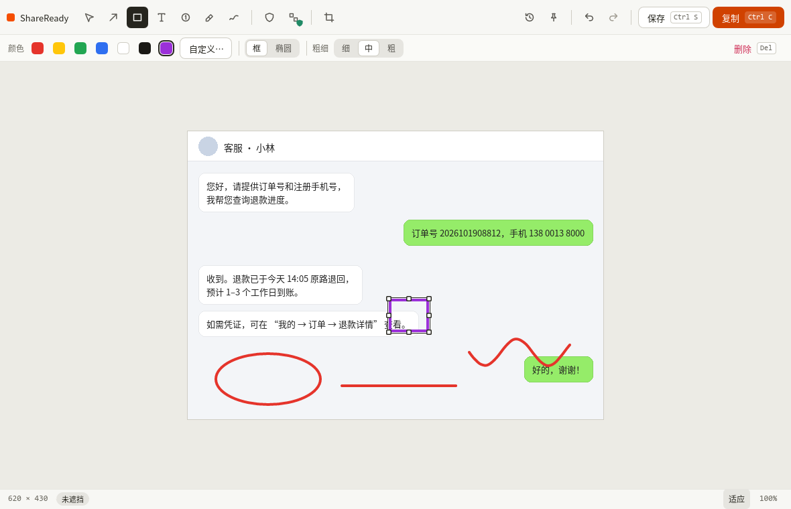

# Anshot (安截)

[中文](README.md) · **English**

**Screenshot, annotate, redact, share on Windows — what you cover is really gone from the export.**

> Version 0.2.0, the first public release, **not code-signed**. All pixel processing and export happen locally in Rust; the app makes no network requests, has no account and no telemetry.
> "Anshot / 安截" is the name used since 2026-10. It has only been checked through public searches and has **not** been trademark-cleared ([naming research](docs/NAMING_RESEARCH.md), Chinese). The project was previously code-named ShareReady and the repository has not been renamed yet.

Press **Ctrl+Shift+A** to capture, add arrows, text and step numbers, cover private parts with a solid block or a **safe mosaic**, then copy or save in one key. Covered areas are replaced by pixels that carry **no information from the original**, and the export is a freshly encoded PNG without source metadata. What the canvas shows is exactly what is exported.



## Download and install

From [Releases](https://github.com/2023violet/ShareReady/releases):

| File | What it is |
|---|---|
| `Anshot-0.2.0-win-x64-setup.exe` | Installer, per user, into `%LOCALAPPDATA%\Programs\Anshot`. **No administrator rights.** Adds a Start-menu shortcut and appears in "Apps & features" for uninstalling. |
| `Anshot-0.2.0-win-x64.zip` | Portable: unzip and run `Anshot.exe` |
| `SHA256SUMS.txt` / `release-metadata.json` | Checksums and build facts (commit, toolchain, an explicit "unsigned" statement) |

**About "Windows protected your PC".** The app is not signed with a paid certificate, so SmartScreen may block the first start. Make sure the file comes from this repository's Releases and that its checksum matches, then choose "More info → Run anyway":

```powershell
Get-FileHash .\Anshot-0.2.0-win-x64-setup.exe -Algorithm SHA256   # compare with SHA256SUMS.txt
```

**Upgrade.** Run the newer installer over the old one; it closes a running copy first.

**Check for updates.** About → "检查更新" only opens the Releases page in your browser; the app itself never connects.

**Uninstall.** Settings → Apps → 安截 Anshot. Settings and history are kept unless you tick the option to delete them, and the start-at-login entry is always removed.

Requires Windows 10 or 11, x64.

## Features

- **Capture.** Use the global hotkey or the tray. Each monitor gets a frozen image of its screen.
  - Drag a region, then adjust it by its edges or move it from the inside.
  - Click to snap to a window, or press Enter for the whole screen. A magnifier shows the pixels under the pointer.
  - A toolbar next to the selection offers **copy / save / pin / long screenshot / edit**.
- **Long screenshot.** Choose a region, press "长截图" and scroll slowly; the app stitches the frames locally. Sticky headers and footers are detected, and you're told when scrolling went too fast.
- **Pin to desktop.** Keep a capture on top of all windows. Drag it, zoom with the wheel, set its opacity, and right-click to copy or save.
- **Annotate.**
  - Shapes and text: arrow, line, frame, ellipse, pen, multi-line text with IME support, auto-numbered steps, highlighter.
  - Colour and size: 6 preset colours plus a custom colour (HSV / HEX, recent colours remembered), 3 stroke widths, 5 text sizes.
  - Hold Shift for squares, circles and 45° lines.
- **Redact.** Solid black or white, or a **safe mosaic** whose colours depend only on position, never on the original. There is deliberately no reversible blur or pixelation.
- **Edit.** Select, move, resize from 8 handles, undo / redo, crop with handles, zoom and pan, Tab through objects, nudge with the arrow keys.
- **Deliver.** Ctrl+C copies. Ctrl+S saves a new PNG and **never overwrites an existing file**: a taken name becomes "name (2).png".
- **History (Ctrl+H).** Keeps the **images the editor copied or saved**, exactly as they were shared: covered where you covered, unchanged where you did not.
  - On by default, keeping 50. Choose 20 / 200 or off, and clear it in one click.
  - Stored **unencrypted** in `%LOCALAPPDATA%\Anshot\history`, and kept on uninstall unless you tick the option to delete it.
  - Frozen full screens, source files and editing state are never written to disk; pin copies are not recorded.
- **Settings (Ctrl+,).**
  - Capture hotkey: 4 choices, with a warning if another app already uses it.
  - Hide or keep the editor after copying.
  - How many history images to keep.
  - Default save folder.
  - Start at login (waits in the tray).

Keys: V select · A arrow · L line · R frame · E ellipse · P pen · T text · N number · H highlight · B redact · M safe mosaic · C crop · 1–6 presets · 7 custom colour · Del delete · Ctrl+Z / Y undo / redo · Ctrl+T pin · Ctrl+H history · Ctrl+0 / 1 fit / 100% · Ctrl+, settings.

## Privacy and security

| Promise | How | Status |
|---|---|---|
| Covered areas carry nothing of the original | Pixels are replaced while rendering in Rust; safe-mosaic colours depend only on coordinates | Unit tests and end-to-end pixel read-back (MEASURED) |
| No source metadata in exports | Freshly encoded PNG; before delivery it is read back and must contain only IHDR/IDAT/IEND | MEASURED |
| No network | No network crates; 0 network endpoints sampled at runtime | MEASURED (this machine) |
| Never overwrite files | `CREATE_NEW` writes; a failed write leaves nothing behind | Unit tests and a real Save-As e2e |
| History keeps only delivered images | Records only the PNG bytes the editor successfully copied or saved (these may contain uncovered content); full screens and source files are never written | Unit tests and e2e |

**Done:**
- A hostile and malformed image corpus plus about 100k-iteration mutation tests. They found a hang and a panic in the JPEG decoder, both now handled ([security testing](docs/SECURITY_TESTING.md)).
- `cargo deny` dependency audit.
- Two independent **agent** security reviews.

**Not done:** a professional third-party audit, coverage-guided fuzzing, code signing.

The app does not detect private information for you; check what you did not cover. To report a vulnerability, see [SECURITY.md](SECURITY.md).

## Build from source

Requires Windows 10 or 11 (x64) and Rust 1.85+ ([rustup](https://rustup.rs)).

```powershell
cargo test --workspace --locked                                   # core crates
cargo test --locked --manifest-path apps/desktop/Cargo.toml       # desktop app
cargo build --release --locked --manifest-path apps/desktop/Cargo.toml
pwsh -File scripts/package.ps1      # portable zip, installer (needs NSIS 3), checksums in dist/
```

Architecture (Rust trust boundary). The UI only sends intents and shows what Rust rendered. Internal crate names still use the old code name.
- `crates/shareready-core`: decoding, redaction, PNG encoding with read-back verification.
- `crates/shareready-render`: scene composition, shared by the export and the canvas preview.
- `crates/shareready-editor`: objects, undo history, version tickets.
- `crates/shareready-platform-windows`: screen capture, hotkeys, clipboard, no-overwrite saving, start at login.
- `apps/desktop`: the Slint 1.18.1 interface.

## Testing and known limits

All machine checks were run by the development agent with real OS mouse and keyboard input:
- unit tests and frozen goldens;
- 30+ end-to-end cases, with the clipboard read back by another process and compared pixel by pixel;
- Chinese IME input and performance;
- install / upgrade / uninstall.

See the [QA report](ui-design/07_UI_QA_REPORT.md) (Chinese).

Known limits:
- No human usability testing. The project chose agent-driven real-input testing instead; the two are not equivalent.
- Tested only on one monitor at 100% scaling on Windows 10. Multi-monitor and mixed DPI, 125%/150% system scaling, Windows 11 and Narrator are **not verified**.
- Not code-signed; no auto-update (manual check).
- Long screenshots need content that scrolls by whole pixels. Animated or parallax pages may fail to stitch, and the panel will say so. A long screenshot over 25 MB is shortened, with a notice.
- When you upgrade or uninstall while the app runs, the installer asks before closing it. Unsaved edits and pins are lost; a silent `/S` run does not ask.

## License

Code: [MIT](LICENSE). UI: [Slint](https://slint.dev), Royalty-free 2.0 (AboutSlint is shown in About). Font: Noto Sans CJK SC ([OFL-1.1](assets/fonts/OFL-1.1.txt)). Third-party list: [THIRD_PARTY_LICENSES.md](apps/desktop/THIRD_PARTY_LICENSES.md).

**Please do not attach real private screenshots to issues.**
