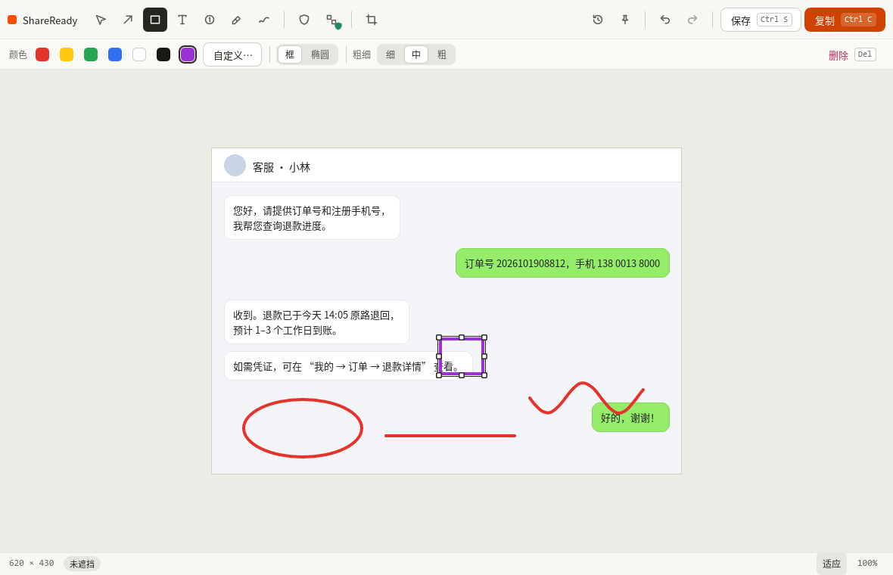
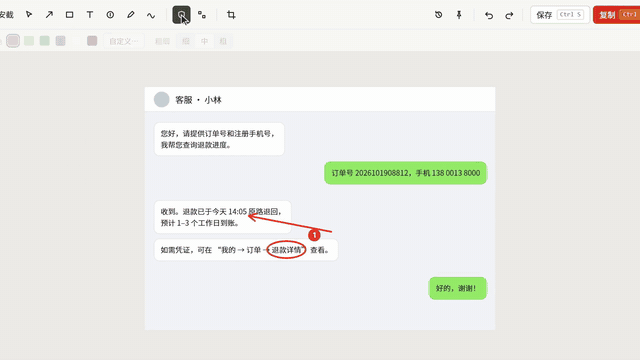

# Anshot (安截)

[中文](README.md) · **English**

**Screenshot, annotate, redact, share on Windows — what you cover is really gone from the export.**

> Version 0.6.0, **not code-signed** (0.2.0 was the first public release). All pixel processing and export happen locally in Rust; the app makes no network requests, has no account and no telemetry.
> "Anshot / 安截" is the name used since 2026-10. It has only been checked through public searches and has **not** been trademark-cleared ([naming research](docs/NAMING_RESEARCH.md), Chinese).

Press **Ctrl+Shift+A** to capture, add arrows, text and step numbers, cover private parts with a solid block or a **safe mosaic**, then copy or save in one key. Covered areas are replaced by pixels that carry **no information from the original**, and the export is a freshly encoded PNG without source metadata. What the canvas shows is exactly what is exported.





*A 10-second, silent excerpt of the 30-second launch film. The mosaic is drawn by the same algorithm as the app; the chat is synthetic test data.*

## Download and install

From [Releases](https://github.com/2023violet/Anshot/releases):

| File | What it is |
|---|---|
| `Anshot-0.6.0-win-x64-setup.exe` | Installer, per user, into `%LOCALAPPDATA%\Programs\Anshot`. **No administrator rights.** Adds a Start-menu shortcut and appears in "Apps & features" for uninstalling. |
| `Anshot-0.6.0-win-x64.zip` | Portable: unzip and run `Anshot.exe` |
| `SHA256SUMS.txt` / `release-metadata.json` | Checksums and build facts (commit, toolchain, an explicit "unsigned" statement) |

**About "Windows protected your PC".** The app is not signed with a paid certificate, so SmartScreen may block the first start. Make sure the file comes from this repository's Releases and that its checksum matches, then choose "More info → Run anyway":

```powershell
Get-FileHash .\Anshot-0.6.0-win-x64-setup.exe -Algorithm SHA256   # compare with SHA256SUMS.txt
```

**Upgrade.** Run the newer installer over the old one; it closes a running copy first.

**Check for updates.** About → "检查更新" only opens the Releases page in your browser; the app itself never connects.

**Uninstall.** Settings → Apps → 安截 Anshot. Settings and history are kept unless you tick the option to delete them, and the start-at-login entry is always removed.

Requires Windows 10 or 11, x64. **Windows only:** capture, the global hotkey, the clipboard and start-at-login call Win32 directly; there is no macOS or Linux build and no port is planned for now.

## Features

- **Capture.** Use the global hotkey or the tray. Each monitor gets a frozen image of its screen.
  - Drag a region, then adjust it by its edges or move it from the inside.
  - Click to snap to a window, or press Enter for the whole screen. A magnifier shows the pixels under the pointer.
  - A toolbar next to the selection offers **copy / save / recognise text / pin / long screenshot / edit**; "Size" sets 1:1 / 4:3 / 16:9 or an exact width and height, Shift keeps the ratio, and R repeats the last area.
  - The magnifier shows the colour under the pointer (Shift+C copies it). Delayed capture (3 / 5 / 10 s) from the tray; the mouse pointer can be included.
- **Recognise text (offline OCR).** From a selection, the editor (Ctrl+Shift+O) or a pin, using the **text recognition built into Windows**: on this computer, no network, no model download. In the editor it reads the export image, so redacted text is not recognised. Results are editable and copyable, never saved, and can contain mistakes. Needs the matching Windows language installed.
- **Check before sharing (Ctrl+Shift+K or the toolbar button).** Recognises text locally and lists what looks like phone, ID and card numbers, mail addresses, IP addresses and keys, with boxes on the canvas (the boxes never reach the image you share).
  - Everything is ticked by default; untick what you want to keep. Nothing changes until you press "Cover selected", and one undo reverts it.
  - Choose a plain cover or "Replace with placeholder" (such as `138 XXXX 0001` or `user-a@example.com`; stand-ins are never derived from the original). With a cover selected you can type your own text, or "Cover same text" finds every other copy in the picture.
  - After each copy or save it checks again (on by default; Settings → Privacy). It never blocks: if something new turns up, "Review" lets you cover it and copy again. When there are covers, it also checks whether the text under them can still be recognised in the result.
  - **An aid only.** On synthetic test images it misses about one value in ten, and it cannot find names, addresses, faces, handwriting or text inside pictures. Recognised text stays in memory: never saved, logged or added to the history.
- **Beautify (Ctrl+Shift+B or the toolbar button).** Puts the capture on a background (8 palettes or colours taken from its edges) with padding, rounded corners and a shadow, at 1:1 / 4:3 / 16:9 / 3:4 / 9:16 (centred, never cut), with optional macOS, Windows or browser window chrome and your own title or address text.
  - While the panel is open the canvas shows the Rust-rendered result and editing pauses. Switching it off restores the plain image; it takes no undo steps.
  - The capture's pixels are identical to the plain export except at the rounded corners, covers included, and the result is always opaque.
  - The window text stays in memory, is never saved in the settings, and is not read by the check before sharing.
- **Step image (Ctrl+Shift+J or the toolbar button).** Lays several captures out as one image with numbers and captions, for how-tos and tickets.
  - Add a step with "Add step" (Ctrl+J) on the capture toolbar, or Ctrl+J in the editor (covers and annotations included), or from history or an image file. With **burst** on, Enter on a selection adds it as a step without opening the editor.
  - In the panel: reorder, one-line captions, edit or delete a step (undoable); vertical / horizontal / grid, spacing, background, numbers, captions, same width. The canvas shows a Rust-rendered preview. "Join and edit" opens a new image in the editor, ready to annotate, check, beautify and copy.
  - Numbers and captions sit above each capture, never over it; unscaled steps keep their pixels exactly; the result is always opaque.
  - **Steps live in memory only:** 20 at most, gone on exit; captions are never saved in the settings; history keeps only the delivered result. Captures that never went through the editor are marked "Unedited" so you can cover and check them after joining.
- **Long screenshot.** Choose a region, press "Long screenshot" and scroll slowly; the app stitches the frames locally. Sticky headers and footers are detected; when only one pane of the area scrolls, only that pane is stitched; you're told when scrolling went too fast.
- **Pin to desktop.** Keep a capture on top of all windows. Drag it, zoom with the wheel, set its opacity, and right-click to copy or save.
- **Annotate.**
  - Shapes and text: arrow, line, frame, ellipse, pen, multi-line text with IME support, auto-numbered steps, highlighter, **spotlight** (dims the rest) and **magnifier callout** (2x, enlarging the redacted picture). Alt+wheel adjusts the selected number, width or text size.
  - Colour and size: 6 preset colours plus a custom colour (HSV / HEX, recent colours remembered), 3 stroke widths, 5 text sizes.
  - Hold Shift for squares, circles and 45° lines.
- **Redact.** Solid black or white, or a **safe mosaic** whose colours depend only on position, never on the original. There is deliberately no reversible blur or pixelation. By default a redaction covers 4 px more all round (less of the hidden text's edges and length leaks, though the length is not fully hidden), and copying or saving an image with no redaction shows a warning.
- **Edit.** Select, move, resize from 8 handles, undo / redo, crop with handles, zoom and pan, Tab through objects, nudge with the arrow keys.
- **Deliver.** Ctrl+C copies. Ctrl+S saves a new PNG and **never overwrites an existing file**: a taken name becomes "name (2).png".
- **History (Ctrl+H).** Keeps the **images the editor copied or saved**, exactly as they were shared: covered where you covered, unchanged where you did not.
  - On by default, keeping 50. Choose 20 / 200 or off, and clear it in one click.
  - Stored **unencrypted** in `%LOCALAPPDATA%\Anshot\history`, and kept on uninstall unless you tick the option to delete it.
  - Frozen full screens, source files and editing state are never written to disk; pin copies are not recorded.
- **Settings (Ctrl+,).**
  - General: language (follow Windows / 中文 / English), capture hotkey (4 choices, with a warning if another app already uses it), hide or keep the editor after copying, delay, include the mouse pointer, start at login (waits in the tray), default save folder, and whether new captures are beautified with the last style (off by default).
  - Privacy: how many history images to keep and for how long (always / 30 / 7 / 1 days), clear the history on exit, the 4 px redaction margin, the no-redaction warning, the check after copying or saving (on by default), and whether copies may enter Windows clipboard history and cloud sync (off by default).

Keys: V select · A arrow · L line · R frame · E ellipse · P pen · T text · N number · H highlight · S spotlight · Z magnifier · B redact · M safe mosaic · C crop · 1–6 presets · 7 custom colour · Alt+wheel adjust the selection · Del delete · Ctrl+Z / Y undo / redo · Ctrl+Shift+O recognise text · Ctrl+Shift+K check before sharing · Ctrl+Shift+B beautify · Ctrl+T pin · Ctrl+H history · Ctrl+0 / 1 fit / 100% · Ctrl+, settings. In the capture overlay: Shift keeps the ratio · Shift+C copies the colour · R repeats the last area.

## Privacy and security

| Promise | How | Status |
|---|---|---|
| Covered areas carry nothing of the original | Pixels are replaced while rendering in Rust; safe-mosaic colours depend only on coordinates | Unit tests and end-to-end pixel read-back (MEASURED) |
| No source metadata in exports | Freshly encoded PNG; before delivery it is read back and must contain only IHDR/IDAT/IEND | MEASURED |
| No network | No network crates; 0 network endpoints sampled at runtime | MEASURED (this machine) |
| Never overwrite files | `CREATE_NEW` writes; a failed write leaves nothing behind | Unit tests and a real Save-As e2e |
| History keeps only delivered images | Records only the PNG bytes the editor successfully copied or saved (these may contain uncovered content); full screens and source files are never written | Unit tests and e2e |

**Done:**
- A hostile and malformed image corpus plus about 100k-iteration mutation tests. They found a hang and a panic in the JPEG decoder, both now handled ([security testing](docs/SECURITY_TESTING.md)).
- `cargo deny` dependency audit.
- Two independent **agent** security reviews.

**Not done:** a professional third-party audit, coverage-guided fuzzing, code signing.

The check before sharing is only an aid and misses things; still look over what you did not cover. To report a vulnerability, see [SECURITY.md](SECURITY.md).

## Build from source

Requires Windows 10 or 11 (x64) and Rust 1.85+ ([rustup](https://rustup.rs)).

```powershell
cargo test --workspace --locked                                   # core crates
cargo test --locked --manifest-path apps/desktop/Cargo.toml       # desktop app
cargo build --release --locked --manifest-path apps/desktop/Cargo.toml
pwsh -File scripts/package.ps1      # portable zip, installer (needs NSIS 3), checksums in dist/
```

Architecture (Rust trust boundary). The UI only sends intents and shows what Rust rendered.
- `crates/anshot-core`: decoding, redaction, PNG encoding with read-back verification.
- `crates/anshot-render`: scene composition, shared by the export and the canvas preview.
- `crates/anshot-editor`: objects, undo history, version tickets.
- `crates/anshot-platform-windows`: screen capture, hotkeys, clipboard, no-overwrite saving, start at login.
- `apps/desktop`: the Slint 1.18.1 interface.

## Testing and known limits

All machine checks were run by the development agent with real OS mouse and keyboard input:
- unit tests and frozen goldens;
- 35 groups of end-to-end cases, with the clipboard read back by another process and compared pixel by pixel;
- 14 check-before-sharing cases and 9 beautify cases on a synthetic fake-data page;
- Chinese IME input and performance;
- install / upgrade / uninstall;
- a 1-hour run of repeated captures.

Measured numbers (0.5.1, this Windows 10 machine with one monitor, agent-measured, MEASURED): installer and program sizes are on the release page; start-up 528–630 ms; hotkey to overlay 41 ms from the tray; opening a 6000×4000 image 806 ms, copying it 1165 ms, peak memory 593 MB; 0 network endpoints at runtime; 720 captures and copies in 1 hour without a crash or memory growth. Machine load differed between measuring days, so not every difference between versions is the program's. Beautifying a 4800×3200 capture takes about 0.5 s (render unit timing, release build).

**HDR (Windows 11):** on a Windows 11 24H2 PC with an AMD Radeon 780M, captures with HDR on went black for seconds and left the screen dim; with HDR off they did not (measured by the user). The mechanism is not known and it is **not fixed**. Since 0.6.0 the capture overlay appears only once drawn, the dimming fades in, and a notice appears once when HDR is on (it can be turned off). Win+Alt+B toggles HDR; Win+Ctrl+Shift+B restores a dim screen. Outside the selection the capture overlay deliberately dims the screen; system brightness is not changed. To help diagnose it, see [`tools/diagnose`](tools/diagnose/README.md).

See the [QA report](ui-design/07_UI_QA_REPORT.md) (Chinese).

Known limits:
- No human usability testing. The project chose agent-driven real-input testing instead; the two are not equivalent.
- Tested only on one monitor at 100% scaling on Windows 10. Multi-monitor and mixed DPI, 125%/150% system scaling, Windows 11 and Narrator are **not verified**.
- Not code-signed; no auto-update (manual check).
- Long screenshots need content that scrolls by whole pixels. Animated or parallax pages may fail to stitch, and the panel will say so. A long screenshot over 25 MB is shortened, with a notice.
- When you upgrade or uninstall while the app runs, the installer asks before closing it. Unsaved edits and pins are lost; a silent `/S` run does not ask.

## License

Code: [MIT](LICENSE). UI: [Slint](https://slint.dev), Royalty-free 2.0 (AboutSlint is shown in About). Font: Noto Sans CJK SC ([OFL-1.1](assets/fonts/OFL-1.1.txt)). Third-party list: [THIRD_PARTY_LICENSES.md](apps/desktop/THIRD_PARTY_LICENSES.md).

History: the project was code-named ShareReady before 2026-10-21; the frozen V1.3 web editor and egui prototype under `web-app/`, `desktop-windows/`, `e1-spike/` and `poc/` keep that name.

**Please do not attach real private screenshots to issues.**
