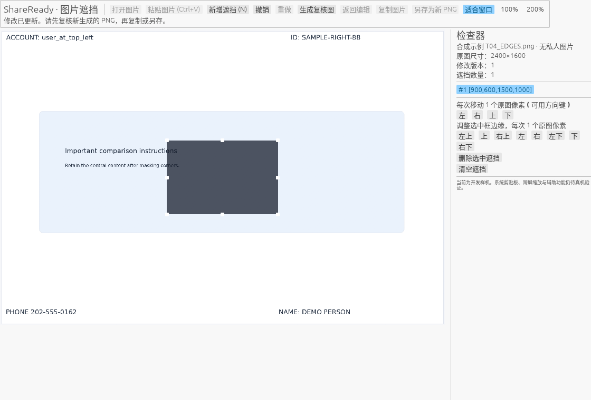
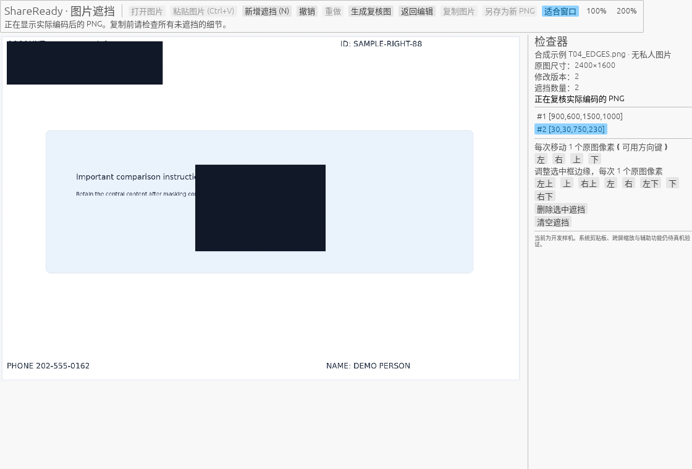
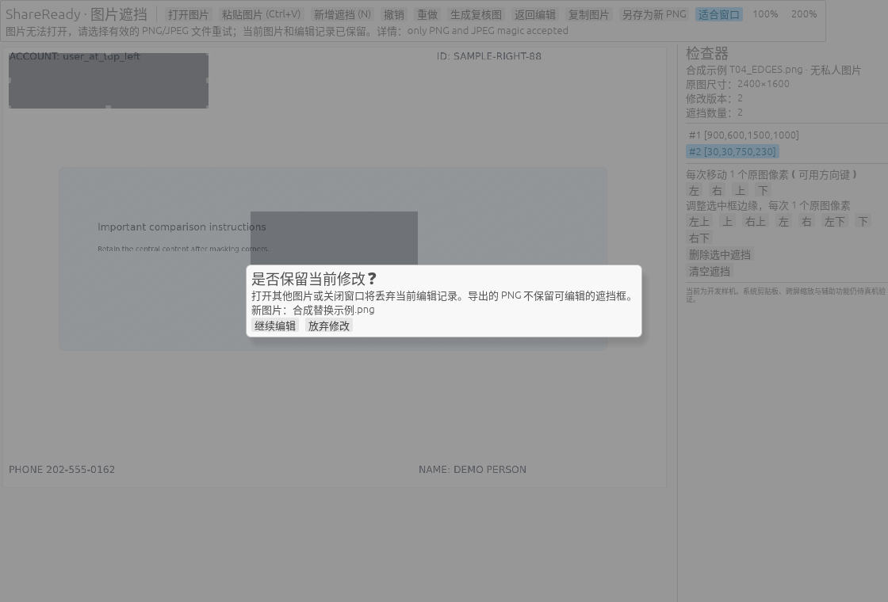
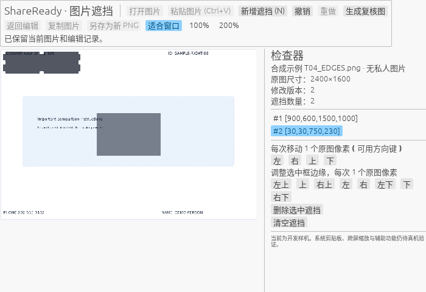

# P03-H：中文工作台与实际渲染取证

本批完成中文界面、合法中文字体、主题背景修正和固定右侧检查器，并对实际原生应用的八个状态取得 GPU 帧缓冲像素。它推进中文工作台和可观察性，不代表 G01～G10、普通人任务或完整产品验收通过。前批 [P03-G](../P03-G/README.md) 的隔离剪贴板创建失败保持原结论；本批没有再尝试提权或访问用户当前剪贴板。

## 可见行为

- 打开、图片粘贴、新增遮挡、撤销/重做、生成复核图、返回编辑、复制、另存为新 PNG、位置调整与丢弃确认使用中文。未添加有效遮挡就复核时给出先添加遮挡的操作提示。底层错误诊断仍可能保留英文；完整错误文案、中文输入法和任意文件名字形不在本批通过范围。
- 加入官方固定版本的 Noto Sans CJK SC Regular 字体作为比例与等宽字体的后备，不替换现有拉丁字体。OTF 原样保留，约 16.44 MB；资源旁保留 OFL、版权元数据和固定来源。没有复制 Windows 系统字体，也没有引入新的运行时依赖或升级锁版本。这里只测开发 EXE，不宣称发布包大小、启动或内存预算通过。
- 背景使用当前主题的不透明面板色。首次实际 GPU 探针发现默认清屏色偏暗且透明，不能与浅色文本配套；新增浅/深主题契约测试并修复。
- 第一轮工作台真实截图显示浮动检查器遮住工具栏与图片角落。因此改为固定右栏和纵向滚动，在 1120×760 与最小 700×480 实际像素图中保持画布、工具栏与检查器各自可见。复核提示使用主题文本，移除浅色底上低对比的固定浅绿。

## 图片与隐私边界

普通模式不创建 trace 或截图。只有显式 `--visual-evidence NEW_LOCAL_DIR` 才会执行内置 T04 合成图片的自动视觉序列；该选项不能与 smoke/trace 混用或重复。Trace 在创建目录前逐字节核对固定 T04，拒绝其他图片。所有 trace 模式在读取之前禁用文件/剪贴板导入，也禁止真实复制与保存入口。

自动序列通过真实 Editor/controller 方法准备状态并渲染，不注入系统鼠标或键盘。取证期间清除交互输入，每次截图携带阶段标记，只接受主视口的当前请求；请求时记录文档、区域、选择、缩放、复核、确认框、主题、尺寸和状态快照，回调状态不一致则失败。PNG 来自实际 `Event::Screenshot`，在 Rust 中经既有 Core DIB 编码边界写入新证据文件；没有用静态页面重画界面，也没有绕过当前产品 Review PNG 的版本凭证。

桌面 computer-use 的两次窗口截图均真实超时，UIA 只返回窗口外壳而没有内部控件，关闭点击也因坐标几何不可用而失败。随后 Alt+F4 关闭请求及进程消失已观察。GPU 取证是据此采用的显式合成替代路径：它证明应用渲染像素，不证明 Windows 合成后的屏幕、物理指针、双屏缩放、Narrator 或人类体验。

## 验证与版本

精确源码、锁、EXE、报告与图片哈希见 [RESULTS.json](RESULTS.json)，独立审查见 [INDEPENDENT_REVIEW.md](INDEPENDENT_REVIEW.md)，材料清单见 [SHA256SUMS](SHA256SUMS)。`main` 和既有 HEAD 保持；没有提交、推送、发布或删除 V1。首轮边验证边修改的候选被身份校验明确拒绝，仅保存作反例；本批通过结果使用冻结后的新构建。

| 检查 | 本批实际范围 |
|---|---|
| 原生 47 项 + 输入桥接 4 项 | 保留原有导入/候选/取消/历史/当前 PNG/失败重试；增加主题、真实字体栅格字形、固定 fixture、截图阶段与变更拒绝 |
| 主 workspace 53 项 | Core、Editor、Windows 保存/内存边界等；与前行不简单相加为独立总数 |
| 独立 PNG 检查器 19 项 | 新 EXE 的真实新文件保存、DX12 smoke Review、视觉序列 Review 均作独立全图像素与 PNG 结构校验 |
| 八张实际 GPU 图 | 编辑、多遮挡选择、实际 PNG 复核、返回编辑、错误、丢弃确认、小窗口、深色主题；主代理及独立审查分别检查 |
| V1 五张冻结金样 | 当前共享 Core 的 release CLI/preview 重建后完整像素通过；JPEG 按冻结 Rust 归一源合同，并保留 Pillow 源解码差异记录 |
| 字体 | 官方固定 commit 字节与许可证核对、Regular/400、106 个代表字符 cmap，以及实际 egui 双字体家族栅格字形检查；不是所有 Unicode/IME 验收 |

### 实际界面图

以下来自同一精确构建的应用 GPU 帧缓冲，均为项目合成图片。取证模式有意禁用导入/真实交付按钮，不能据此推断正常模式的系统剪贴板交付能力。

其他状态：[多遮挡](visual/multi.png)、[返回编辑](visual/back-edit.png)、[错误](visual/error.png)、[深色主题](visual/dark.png)。

## 验收差距与下一步

| 门槛 | 当前证据与未完成项 |
|---|---|
| G01 精确遮挡 | Rust 几何、实际指针事件单测与独立输出检查已有；物理拖动/手柄端到端仍 NOT_VERIFIED |
| G02 手柄/键盘/历史 | 几何、状态/焦点/快捷键与桥接条件测试已有；真实八手柄/1px/完整键盘任务与焦点可见性仍未完成 |
| G03 DPI/双屏 | 物理像素缩放定义与合成坐标回归已有；本机两屏实际缩放、跨屏路由仍 NOT_VERIFIED |
| G04 24MP/性能 | 小图实际帧可见；24MP 原像素复核、峰值内存、帧时与预算测量是下一独立任务 |
| G05 导入 | 文件上限、候选准备/恢复与坏图有测试；真实 Explorer/对话框/格式组合仍未全部完成 |
| G06 剪贴板 | PNG/DIB/自有内存与复制恢复已有；G 的隔离方式失败，真实 Ctrl+V、Paint 和第二应用回贴仍 NOT_VERIFIED |
| G07 保存 | 新文件句柄、失败回滚/取消/重试与实际新文件输出已有；更多文件系统/故障环境未完成 |
| G08 中文/辅助功能 | 本批中文与 GPU 字形证据；中文 IME、Narrator、可访问树/完整任务仍 NOT_VERIFIED |
| G09 版本/交付 | 过期凭证、修改后复核、错误恢复有回归；真实系统/长周期交互补测继续 |
| G10 本地/包/依赖 | 锁未变、字体来源/OFL 固定；离线包、全依赖许可、安全审查和发布验收仍未完成 |

继续按总方案推进 24MP 与性能实测、真实交付和辅助功能。使用 [连续本地授权](../../governance/AUTONOMOUS_LOCAL_DEVELOPMENT.md) 的 genuine A/B/review 确认为代理行为，不称人类逐 token 审阅；完整产品目标保持进行中。

字体来源：[官方固定字体文件](https://github.com/notofonts/noto-cjk/blob/f8d157532fbfaeda587e826d4cd5b21a49186f7c/Sans/OTF/SimplifiedChinese/NotoSansCJKsc-Regular.otf)、[对应 OFL 许可证](https://github.com/notofonts/noto-cjk/blob/f8d157532fbfaeda587e826d4cd5b21a49186f7c/Sans/LICENSE)。
