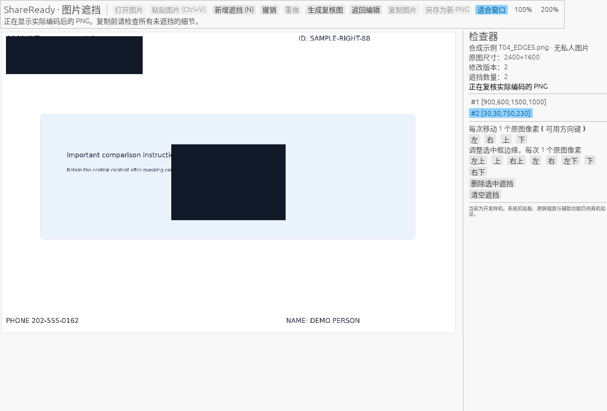
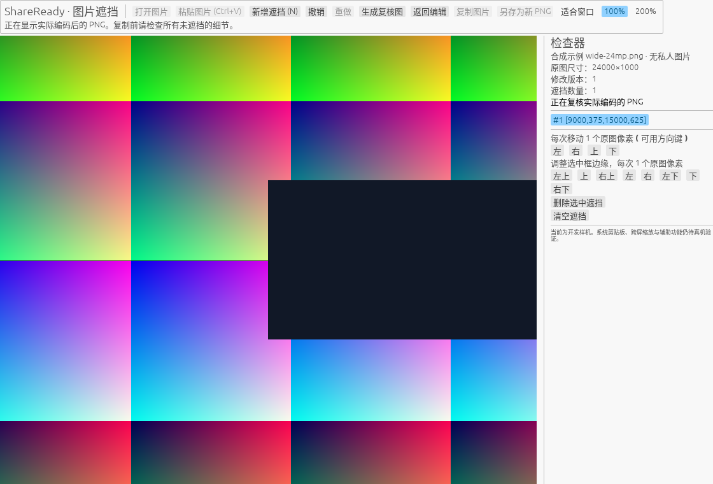

# P03-I：24MP 实测与生成 PNG 读回修正

本批对当前 Rust 原生工作台完成了固定合成图的 release 组件测量、八组真实窗口测量和完整输出像素校验，并修复两项有实际反例的问题：大成品被误套用源文件大小上限，以及默认 GPU 抖色使显示通道偏离源像素。阶段结论为 **MEASURED WITH LIMITS**；性能预算仍是候选，G04 与完整产品验收保持开放。

版本、源码、EXE、原始报告及样本身份以 [RESULTS.json](RESULTS.json) 为准；分布与二十轮抽样见 [METRICS.json](METRICS.json)，原始工件清单见 [ARTIFACTS.json](ARTIFACTS.json)，独立审查见 [INDEPENDENT_REVIEW.md](INDEPENDENT_REVIEW.md)。本页是当前局部证据的解释，不代表发布批准。

## 已修正的行为

合法的 3000×3000 合成 JPEG 只有 8,077,834 字节，但经 Rust 归一后生成的 PNG 达 36,005,813 字节。旧原生复核路径调用源图解码器，因 25 MiB 上限失败。本批先用实际 `start_review` 固定失败，再增加单独的生成物读回边界；当前 Review 和 Copy 凭证所拥有的 PNG 使用该路径。实际遮挡成品 35,028,967 字节能够复核、保存，并由受控 Copy 接收函数取得与 PNG 全图一致的 36,000,000 字节 RGBA。

源文件和剪贴板导入仍走 25 MiB / 24MP 的不可信输入边界；大成品再次作为源导入仍拒绝，原编辑和凭证保留。生成物边界为 PNG、RGBA8、非交错、当前精确尺寸及 24MP，编码字节最多 128 MiB；逐块检查长度、CRC、IHDR、连续 IDAT、唯一 IEND 与精确文件结尾，拒绝 metadata、APNG 和尾随载荷。128 MiB 来自锁定编码器的最坏编码长度推导，不能作为任意 PNG 的通用信任依据。解码器配置的分配限制属于尽力约束，不是操作系统内存上限；函数不能独立证明来源或遮挡有效性，调用者必须持有当前版本的生成物凭证。

第二项修正来自精确显示反例：默认抖色使部分不透明整数颜色偏差 1。单变量实验关闭抖色后严格检查通过，因此普通应用也设置 `dithering=false`，保留 NEAREST 与 Rust 导出编码。没有通过加大像素容差、降低源分辨率或替换金样来消除失败。

## 实际测量范围

设备为 Windows 10 19045、i5-10200H、约 15.83 GiB RAM、NVIDIA GTX 1650，真实 DX12 设备。适配器报告最大纹理边长 16384，egui 实际设备上限 8192。样本为 6000×4000 和 24000×1000 的固定合成 PNG，含中央 1px 黑线和可计算像素；它们是低熵图，不能代表所有合法 24MP PNG/JPEG。

八组包括五次新进程启动、一次二十轮有界导入及复核、宽图原生上限、宽图图片纹理上限 512 的诊断分块。每组取得 Fit、100%、200%、远端复核与中央遮挡复核五张实际 GPU 读回图，并采集 30 个不同累计帧编号的最终交互帧。512 只限制图片缩略图和分块，字体图集保持真实设备上限；报告验证至少一张严格检查图包含实际多 tile 接缝。32 张原像素图的可见内部逐像素比较，编辑手柄/边界明确排除；另外 8 张 Fit 图仅为下采样预览，不作原像素一致断言。中央复核必须同时命中足量遮挡内部和未遮挡像素。

| 指标 | 本轮观测 | 对候选预算的解释 |
|---|---|---|
| 五次首图 GPU 读回 | 约 1.13～2.43 秒 | 新进程、OS 缓存未清；不是冷机或首次可操作显示。历史先前完整轮次曾见 5.07 秒，保留原记录，不据两轮快慢声称优化因果 |
| 每组交互 controller＋全部 UI pass CPU P95 | 约 1.36～2.18ms | 含状态转换帧，最大值仍保留；不等于 GPU 帧时或物理输入到显示延迟 |
| 帧间隔 P95 | 原始分组见 METRICS | 包含调度、前一阶段和取证影响，不用 CPU P95 代替 33.3ms 的最终用户预算 |
| 二十轮实际导入 controller | 中位约 502ms，最大约 517ms | 仍同步执行；100ms 内可见反馈未验证，需下一批处理阻塞 |
| 二十轮复核 controller | 中位约 1.78 秒，最大约 1.90 秒 | 含当前 PNG 生成、校验与显示准备；5 秒候选在该样本中有余量，不能扩展到所有输入 |
| 二十轮进程生命周期峰值工作集 | 759,975,936 字节，约 724.77 MiB | 当前约 16GB 设备，非 8GB 参考档；不含独立 GPU 显存，不据此冻结 1GiB 预算 |
| 实际新文件保存 | 各组约 2～7ms | 仅当前新文件与本地磁盘场景，未覆盖完整故障环境 |

计时分别保留 controller CPU、App UI CPU、帧间隔、先前 integration CPU、GPU 读回可用时间与证据编码/写盘。30 帧期间缓冲记录，重复阶段心跳置于计时阶段外。GPU timestamp、物理鼠标键盘端到端延迟未测。内存监视只查询本批新建子进程，记录实际采样间隔、抽样工作集、OS 生命周期峰值及 private commit；这些值不互换。二十轮释放显示后仍保留当前成品，抽样可能重叠下一轮导入，不是稳定空闲或无泄漏证明。2GiB / 120 秒保护线是试验停止条件，不是产品预算。系统后台负载未控制。

## 回归与独立证据

- 主 workspace 58 项、普通 Native 48＋输入桥接 4 项、诊断 Native 53＋桥接 4 项通过；诊断方法的 8 项 Python 检查通过，含错误复核图、不可见遮挡、1px 错色和实际多 pass 反例。
- 普通新 EXE 的独立 PNG 检查器 19 项、实际新文件输出、DX12 smoke 和八个真实 GPU 状态通过。主代理与独立审查者分别看图，明确为 GPU 读回。
- 当前 release 的五张 V1 冻结金样完整像素通过；JPEG 采用冻结 Rust 归一源合同，独立 Pillow 解码/遮挡比较不冒称独立 JPEG 解码一致。
- 24MP 组件两图、窗口实际保存输出、大成品和 Copy RGBA 均有独立完整像素检查。受控 Copy 不访问 OS 剪贴板，不代表 Paint 或第二应用回贴通过。
- 共享核心的真实 WASM 与隔离浏览器补验状态、工具身份和局限见 RESULTS；浏览器自动任务不能代替 Windows WebView2 或人类辅助功能验证。

### 实际应用画面

以下均为固定合成样本。普通视觉取证模式禁用私人导入和真实交付按钮；不能从灰色按钮推断普通模式没有相应能力。宽图中央复核同时显示实心遮挡和未遮挡的原像素。

## 保留的差距与下一批

G04 获得当前设备的 24MP 原像素、资源和计时证据，但参考硬件、物理响应和冻结预算尚未满足。G03 混合 DPI 双屏、G06 系统剪贴板与两应用回贴、G08 Narrator/IME/语义树、人类核心任务，以及完整离线包、依赖许可与安全审查继续标为 NOT_VERIFIED。P03-G 的权限能力探针保持停止，未提权或读取用户剪贴板。

下一批优先处理已测同步导入/复核阻塞：先设计最小后台任务与版本身份、取消/换图/过期结果丢弃及可见忙碌状态，再通过新 genuine Gate A/B 执行；不得在后台结果返回时绕过当前 PNG 凭证。随后继续辅助功能、真实交付与包的缺口。本地连续授权允许代理确认流程 token，这些记录均为 agent，不称人类逐 token 审阅。`main`、预期 HEAD、总方案/PDF、V1、冻结样本和既有锁保持，没有提交、推送、发布或删除。
